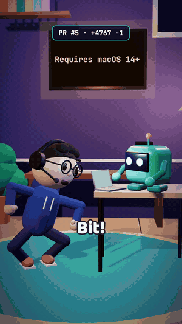

# shipskit

Turn a pull request into a 30-second 3D skit. A stressed developer and a calm robot act out
what you shipped, with your real diff on the wall screen, voices, captions, sound and music.
Everything is rendered from code on your machine.



[Watch the full video with sound](https://github.com/Louayzouaoui1/shipskit/releases/download/v1/claude-hud-pr-5.mp4)
(50 seconds), made from [this pull request](https://github.com/Louayzouaoui1/claude-hud/pull/5).

```
shipskit brief 42                    # what changed in PR #42, as a brief
# write .shipskit/pr-42/episode.json (Claude Code does this with the skill)
shipskit make .shipskit/pr-42        # voices + video → .shipskit/pr-42/pr-42.mp4

shipskit auto 42                     # or all of it in one go
```

## Install

Needs Node 20.19 or newer. For pull requests, the GitHub CLI (`gh`) must be signed in.

```
git clone https://github.com/Louayzouaoui1/shipskit && cd shipskit
npm install --ignore-scripts
npm link                                           # puts `shipskit` on your PATH
ln -s "$PWD/skill/shipskit" ~/.claude/skills/shipskit   # the Claude Code skill
```

Then, in Claude Code, inside any repository: **"make a shipskit video of PR 42"**.

## A video on every merged pull request

`shipskit auto <pr>` does every step itself: Claude Code writes the script with the login it
already has, so there is no Anthropic API key. In GitHub Actions that login is a token from
your Claude subscription:

1. Run `claude setup-token` and save the token as the repository secret `CLAUDE_CODE_OAUTH_TOKEN`.
2. Optional: save a Gemini key as `GEMINI_API_KEY` for better voices.
3. Add `.github/workflows/shipskit.yml`:

```yaml
name: shipskit
on:
  pull_request_target:
    types: [closed]
permissions:
  contents: read
  pull-requests: write
jobs:
  video:
    if: github.event.pull_request.merged
    runs-on: macos-latest # the built-in voices need macOS; with a Gemini key any runner will do
    timeout-minutes: 20
    steps:
      - uses: Louayzouaoui1/shipskit@v1
        with:
          claude-token: ${{ secrets.CLAUDE_CODE_OAUTH_TOKEN }}
          gemini-key: ${{ secrets.GEMINI_API_KEY }}
```

Each merged pull request then gets a comment with a link to its video. The action is new:
if it fails on your runner, please open an issue with the log.

The workflow never checks out or runs the pull request's code. It reads the title, description
and diff as text, Claude gets no tools while writing the script, and the script is used only
if it passes `shipskit check`.

## How it works

1. `shipskit brief <pr | commit | a..b | file>` collects the title, commits and diff. Lockfiles
   and built files are dropped and the diff is cut to a readable size.
2. A script is written as `episode.json`: who says what, how they act, what the screen shows.
   The Claude Code skill in `skill/shipskit` holds the format and the writing rules. You can
   also write or edit the file by hand.
3. `shipskit voice <dir>` records each line. A line that has not changed is not recorded again.
4. `shipskit render <dir>` renders a 1080×1920 MP4 with [Remotion](https://remotion.dev) and
   three.js. `shipskit make <dir>` does 3 and 4. `shipskit check <dir>` only checks the file.

The script only names acts (`panic`, `facepalm`, `type`…). The director (`src/director.ts`)
turns them into camera cuts and poses that are known to look right, so a generated script
cannot put a hand through a head.

## Voices

| Setting | Voice |
|---|---|
| `GEMINI_API_KEY` set | Gemini speech (best) |
| `SHIPSKIT_TTS=vertex` | The same voices through Google Cloud, with `gcloud` signed in |
| neither, on macOS | The built-in `say` voices (free, robotic) |

`SHIPSKIT_TTS_MODEL` changes the Gemini speech model. With Gemini, the lines of the script are
sent to Google as text.

## Develop

```
npm run studio    # the player in Remotion Studio
npm run check     # types and tests
npm run sounds    # rebuild the sounds and music (all made from maths in scripts/sounds.mjs)
```

## Licence

The code, characters and sounds here are MIT. Rendering uses Remotion, which has its own
licence: free for individuals and companies of up to three people, paid above that. Check
[remotion.dev/license](https://remotion.dev/license) before using shipskit at a larger company.
